<h1 align="center">WinStatusBar</h1>

<p align="center">
  <b>A native Windows 11 status bar with a built-in AI assistant.</b><br>
  Chat with several AIs using the context of the active window, keep an eye on your hardware and AI quotas,<br>
  and let the assistant automate your PC — files, Office, settings and apps — with verified, background-first actions.
</p>

<p align="center">
  <a href="https://github.com/smendesjunior/WinStatusBar/releases/latest"></a>
  
  
  
</p>

<p align="center">
  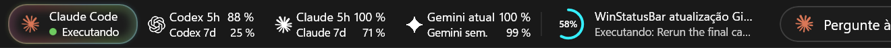
  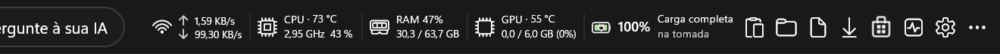
</p>

<p align="center"><sub>Docked at the top of the screen like a native Windows AppBar. Screenshots show the Portuguese (Brazil) interface; English, Spanish, French, Japanese and Simplified Chinese are included.</sub></p>

## Install

```
winget install winstatusbar
```

Or download **`WinStatusBar-Setup.exe`** from the [latest release](https://github.com/smendesjunior/WinStatusBar/releases/latest) and run it: a 3-step wizard installs the bar for the current user, with no administrator rights. The installer is not code-signed yet, so Windows may show a SmartScreen prompt the first time (More info › Run anyway). winget installs don't show it.

**Requirements:** Windows 10 (19041) or Windows 11, 64-bit. The .NET runtime and Windows App SDK are bundled; the Microsoft Edge WebView2 Runtime is installed automatically if it is missing.

---

## Ask your AI from anywhere

One box at the center of the bar talks to **Claude Code, Codex, Gemini, Microsoft Copilot, Lenovo Qira, local models (Ollama)** or your own API key. The active window is attached as context, and with **Edit** on, the assistant can work on your files, folders, Office documents, settings and apps — checking every step.

<p align="center">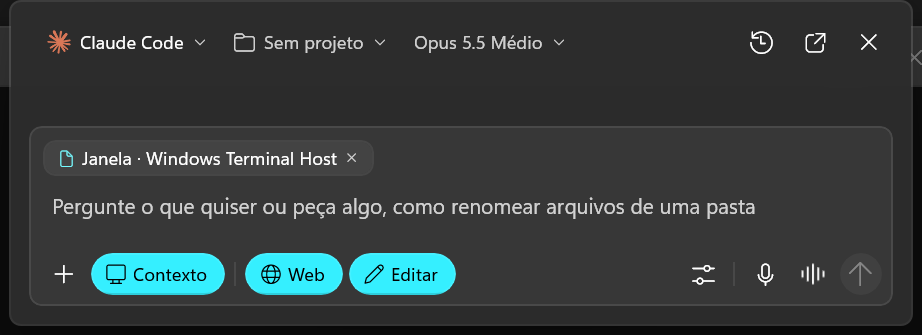</p>

## Every AI at a glance

See which agent is working, what it is doing right now and how much of each plan is left — Codex, Claude Code, Gemini, Copilot, Qira and local AI side by side. The bar can follow the busiest agent automatically.

<p align="center">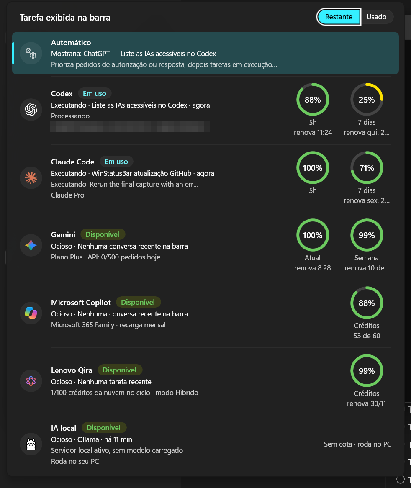</p>

## Quotas without opening a browser

Five-hour and weekly windows, reset times, per-product usage and, for the OpenAI API, tokens, spending and requests.

<table>
  <tr>
    <td width="65%">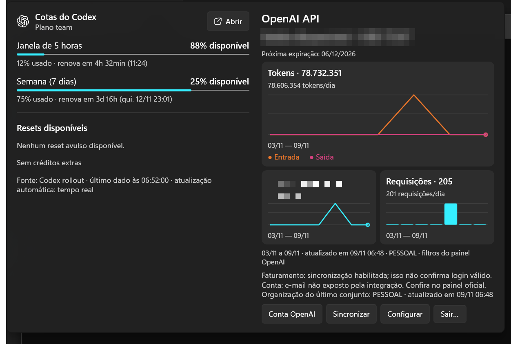</td>
    <td width="35%">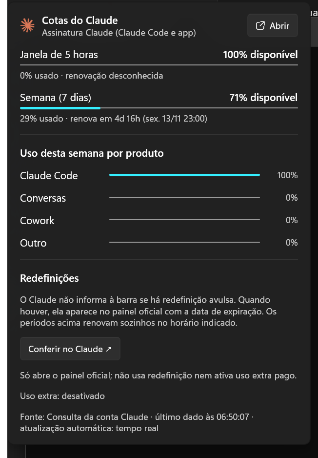</td>
  </tr>
</table>

## Hardware at a glance

Click any metric for a live panel in the style of Task Manager: usage history, temperatures (when the PC exposes sensors), top apps with **End task**, memory composition, GPU engines, Wi-Fi, Bluetooth, hotspot and a speed test.

<table>
  <tr>
    <td>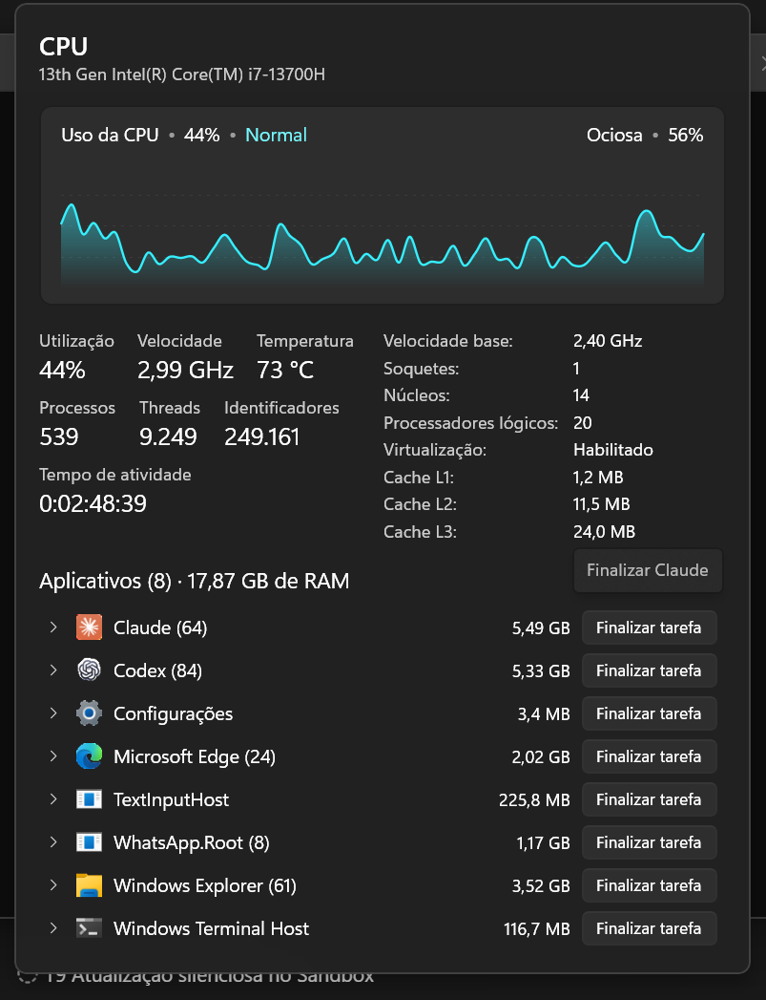</td>
    <td>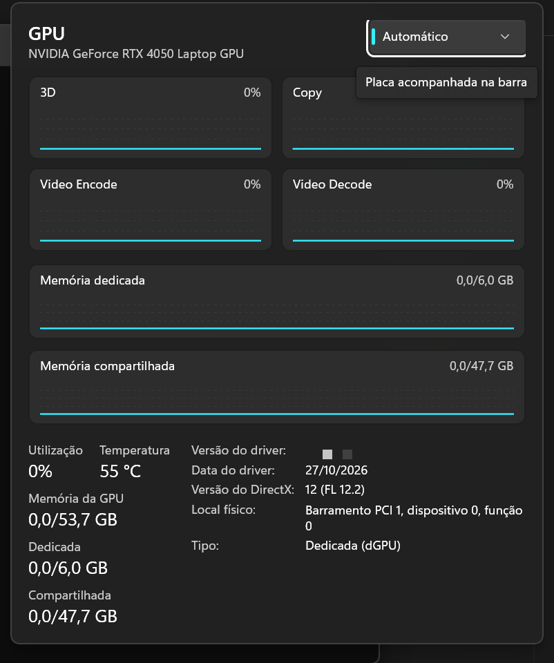</td>
  </tr>
  <tr>
    <td>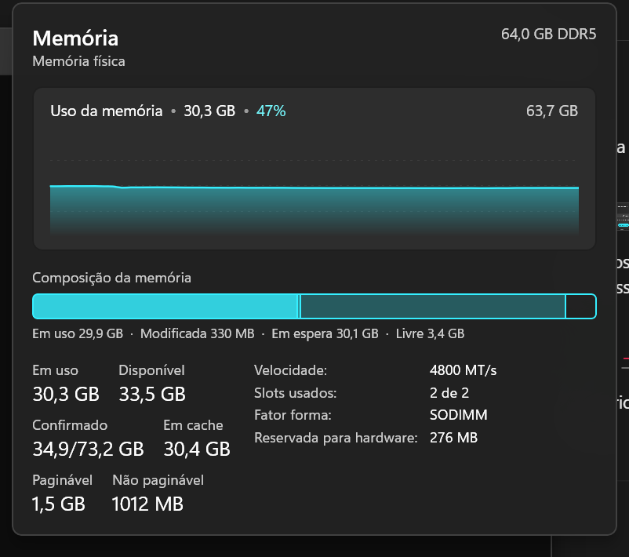</td>
    <td>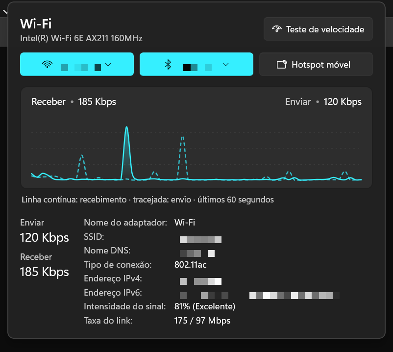</td>
  </tr>
  <tr>
    <td colspan="2" align="center">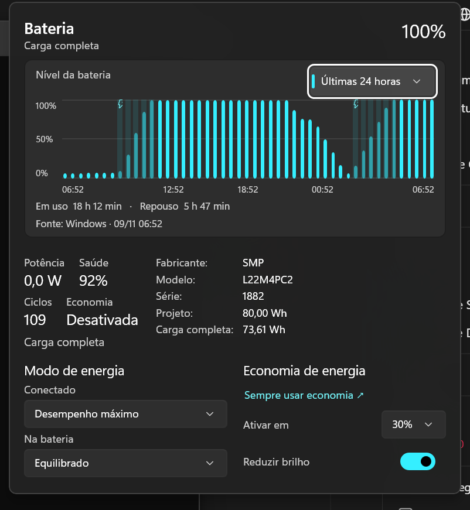</td>
  </tr>
</table>

## And more

- **Codex model picker** — the bar's AIs also show up in Codex's model selector, through a local gateway.
- **Clipboard history and emoji picker**, Windows shortcuts and a light/dark look that follows Windows.
- **Settings › Updates** shows the installed version, a **Check for updates** button and what changed in each version.

## Updates

The installed bar checks [GitHub Releases](https://github.com/smendesjunior/WinStatusBar/releases) every 15 minutes and updates itself silently: it downloads the new installer, verifies its size and SHA-256 against the release manifest and reinstalls in the background — no prompts, no administrator rights.

## Privacy

- No telemetry.
- The Claude Code hook collector only sends metadata (event, tool, file name, a short description) over a named pipe restricted to your Windows user — no conversations, file contents or credentials.
- API keys are stored in the Windows Credential Manager on this PC and are never synced.
- Logins for Claude Code, Codex, Gemini and Copilot stay with those tools; the bar only reads what it needs to show quotas and status.

## Build from source

Requires the [.NET 10 SDK](https://dotnet.microsoft.com/download) on Windows (x64).

```
dotnet test tests/WinStatusBar.Tests/WinStatusBar.Tests.csproj -c Release
powershell -File tools/build-release.ps1 -SandboxTest
```

`tools/build-release.ps1` runs the tests, publishes the app (self-contained), packs it into a single installer and, without `-SandboxTest`, publishes the release to GitHub.

| Project | Purpose |
|---|---|
| `src/WinStatusBar` | WinUI 3 app: the bar, panels, chat and settings |
| `src/WinStatusBar.Core` | Collectors and logic without UI (metrics, AI integrations, updates) |
| `src/WinStatusBar.Collector` | Minimal collector called by Claude Code hooks |
| `src/WinStatusBar.Sensors` | Temperature sensor reader |
| `src/WinStatusBar.Automation` | Desktop automation helper |
| `src/WinStatusBar.CodexIAs` | Local gateway that brings the bar's AIs to Codex |
| `src/WinStatusBar.Setup` | Per-user installer and uninstaller with the 3-step wizard |

## Changelog

See [CHANGELOG.en.md](CHANGELOG.en.md).

---

<sub>© 2026 Sidney Junior. All rights reserved. Claude, Codex, ChatGPT, Gemini, Copilot, Qira, Ollama, Windows and other names belong to their respective owners; WinStatusBar is not affiliated with these companies.</sub>
